# Duo Dash

**A CarPlay-style dashboard for your iPhone, built for the foldable iPhone Duo.** · [duodash.app](https://duodash.app)

Unfold an iPhone Duo on a dash mount and it becomes a head unit: maps with turn-by-turn,
Apple Music and Spotify, calls and texts, and a voice assistant that plans your trip. It
follows the CarPlay layout, in one app with nothing to hand off.

Made for the iPhone Duo, and it also runs on any iPhone or iPad on iOS 26: the layout adapts to
whatever window it's given, so a spare iPhone or an iPad mini on a dash mount works too.

> **⚠️ For passenger use only. Don't use Duo Dash while driving.** Set your route and music
> before you set off, and follow your local road rules.

[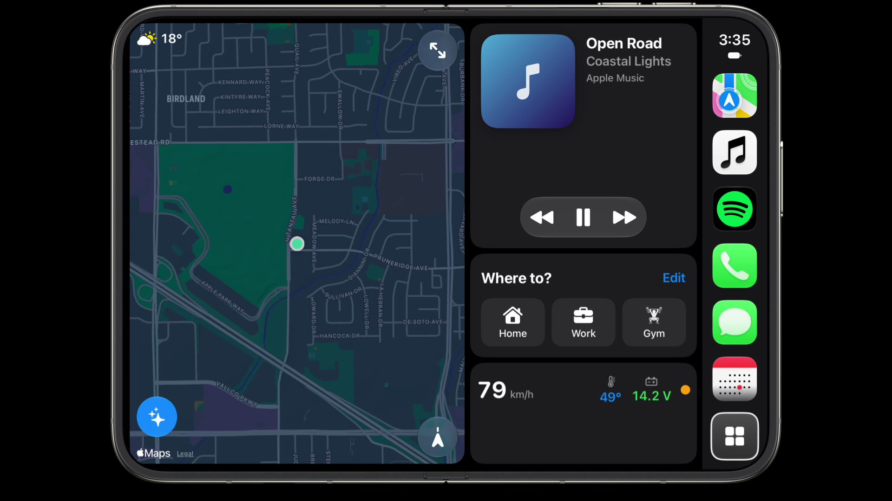](docs/media/duo-dash-demo.mp4)

*▶ [Watch the demo video](docs/media/duo-dash-demo.mp4)*

<p>
  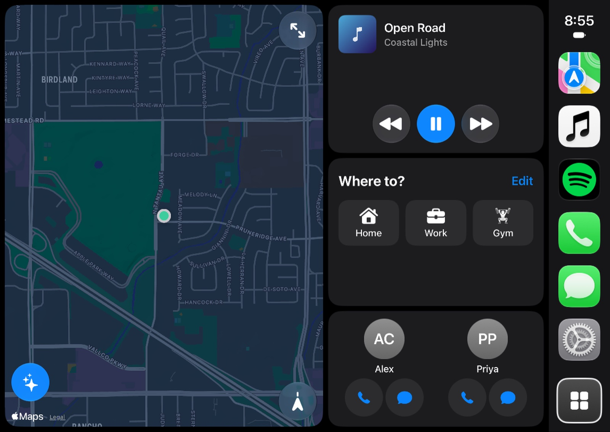
  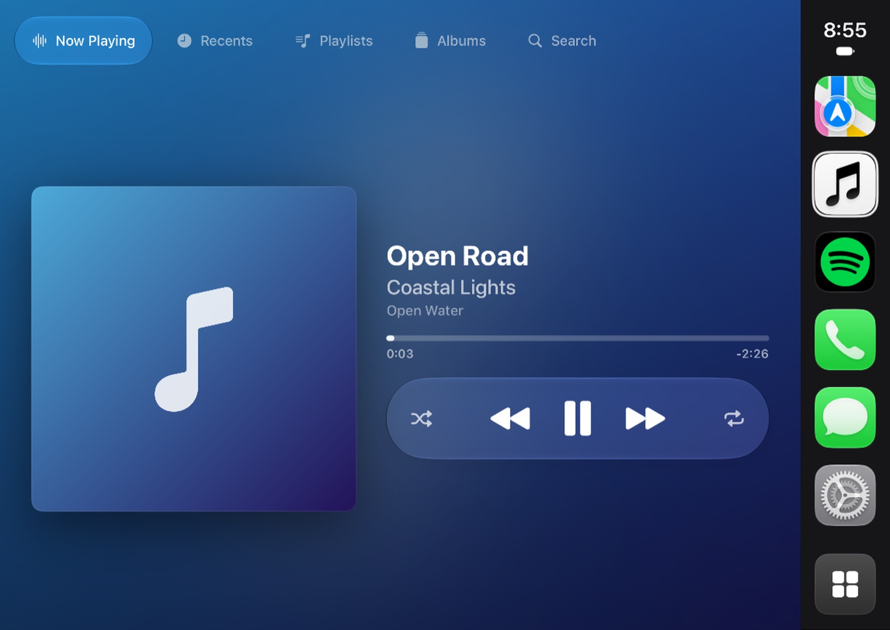
</p>
<p>
  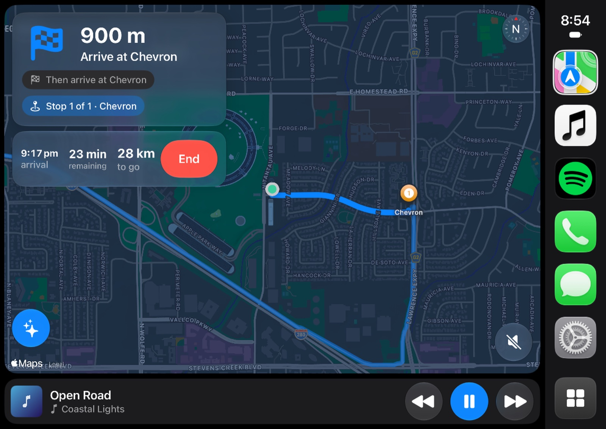
  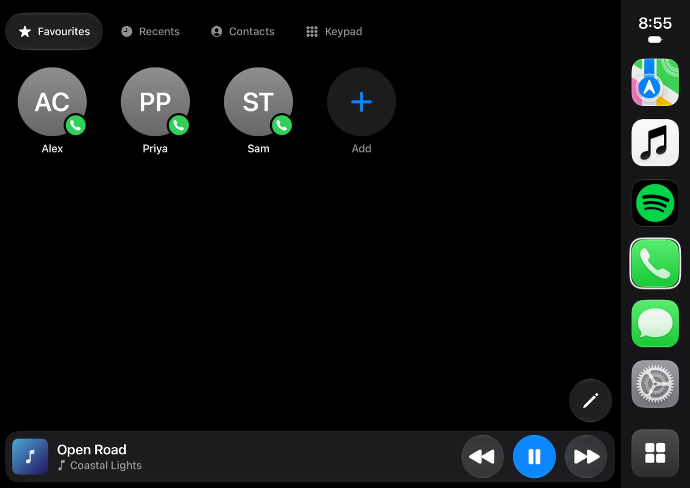
</p>
<p>
  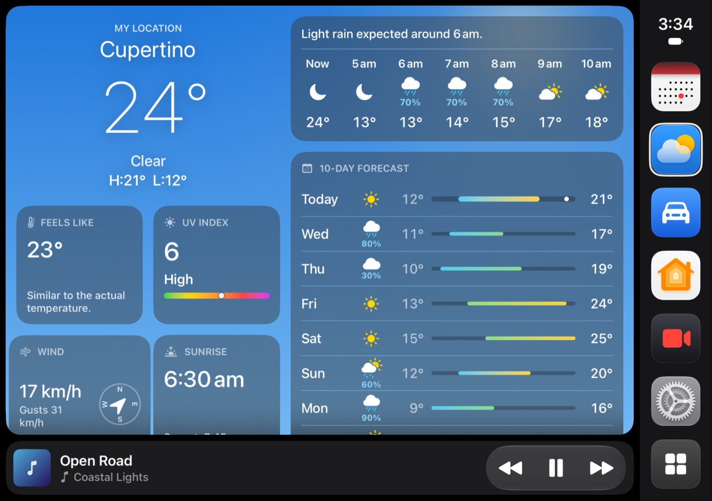
  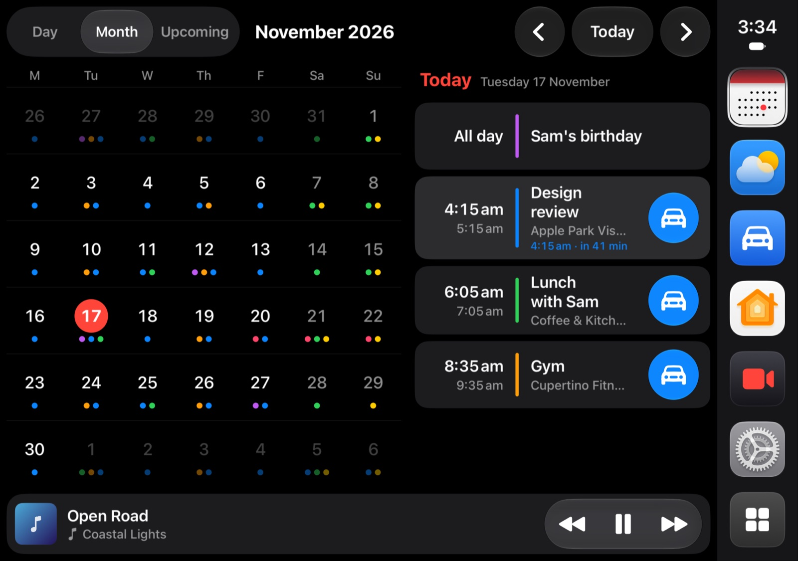
</p>
<p>
  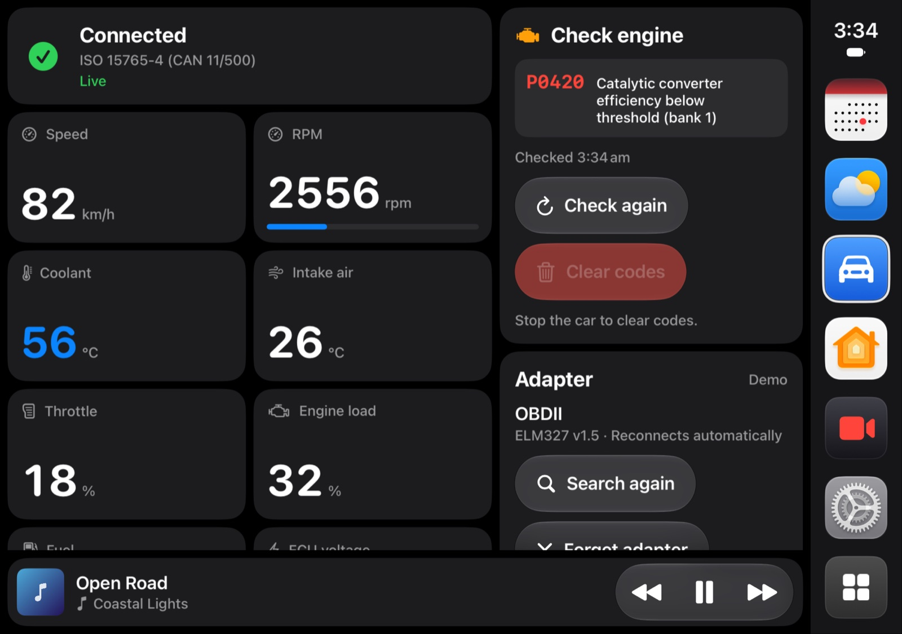
  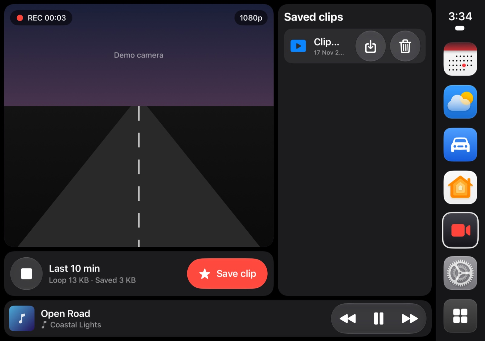
</p>
<p>
  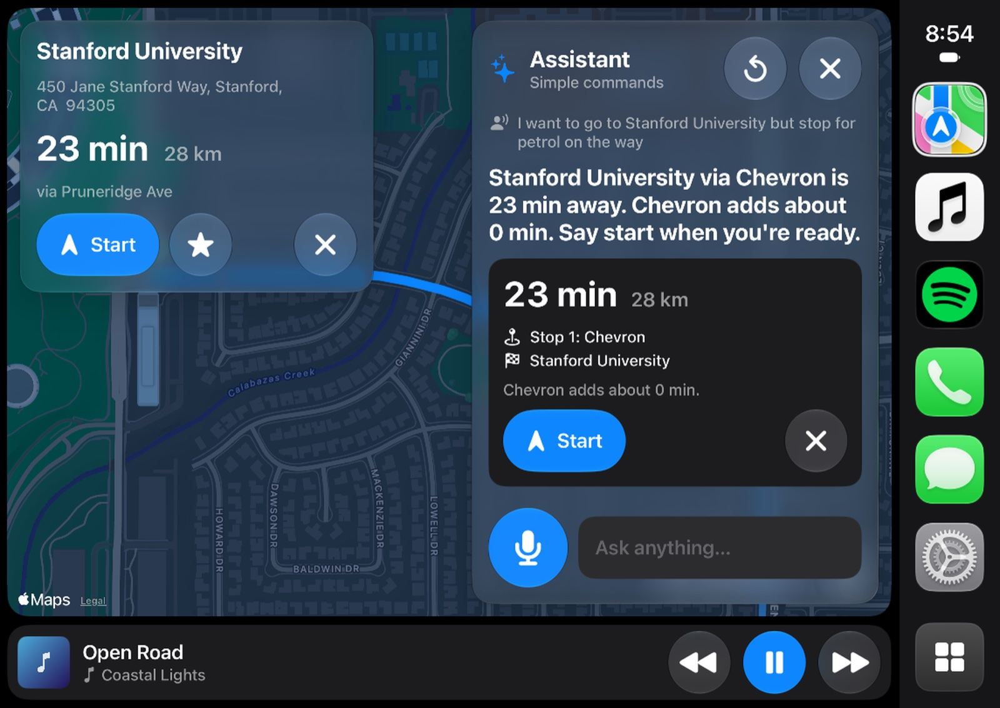
  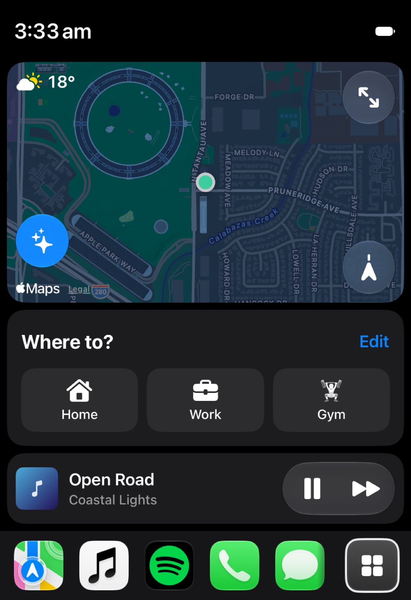
  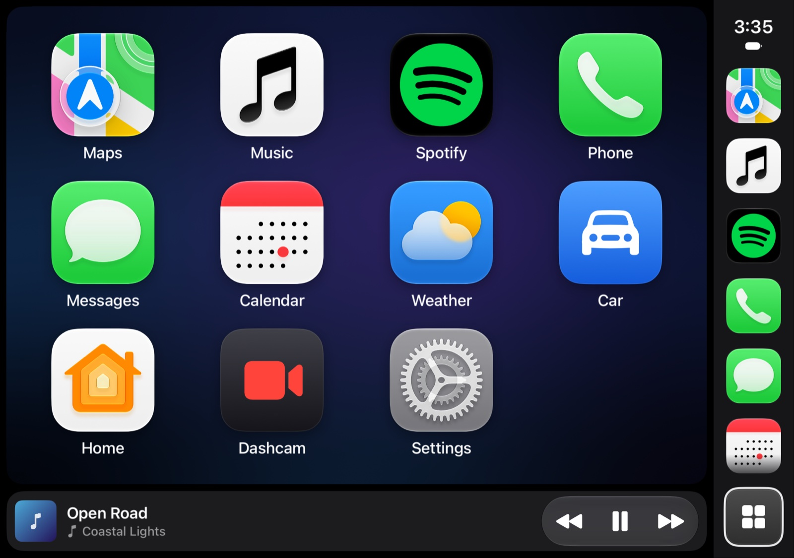
</p>

## Features

**The dashboard**
- The CarPlay layout: on a wide screen, a full-height dock on the right with the clock on
  top and a dashboard button at the bottom. On a tall or narrow screen, a bottom bar.
- The dock scrolls instead of shrinking icons. Press and hold an icon to drag it into a new
  order, and the order is remembered.
- Home dashboard:
  - a live map;
  - what's playing;
  - **Where to?** with your saved places;
  - favourite contacts;
  - the assistant.
- On the iPhone Duo, the dashboard's split lines up with the fold when the phone is half
  open.
- It works in every posture: unfolded landscape or portrait, folded on the cover screen,
  half open, and in Split View beside another app.

**Maps**
- Search by typing or by voice.
- **Saved places**: as many as you like, each with your own name and a greyscale emoji.
- Turn-by-turn directions with a turn banner and rerouting. Spoken directions lower your
  music, are off by default, and your choice is remembered.
- **Trips with stops**, and if the app is killed mid-trip it resumes where you were.
- **Heading up** or **north up** when you're just looking around.
- **Copied addresses**: copy one from Messages or Messenger and Maps offers to take you
  there, with no paste prompt.
- **Navigate with Google Maps or Waze** if you prefer (Settings → Navigation): every Go and
  Start hands the trip to that app, stops included for Google Maps, while Duo Dash keeps the
  route preview with time, distance and destination weather. On the Duo, Split View shows Duo
  Dash beside it.

**Voice assistant**
- Ask out loud:
  - "find somewhere for dinner";
  - "take me to Sam's house";
  - "take me to the airport but stop for petrol on the way".
- It searches Apple Maps, looks up addresses in your contacts, and picks the stop that adds
  the least time. Then it starts navigating.
- It runs on **Apple Intelligence**, on the device and free, or **Claude** with your own API
  key. Claude adds live web search for reviews and opening hours.

**Music**
- **Apple Music**:
  - recents, playlists and albums with **every song listed**; tap any song to play the
    list from there;
  - search by voice;
  - a full-screen player in the style of Apple Music, with blurred album art behind it and
    Liquid Glass controls.
- **Spotify** (Premium, through the Spotify app; see [Spotify's limits](docs/SPOTIFY_SETUP.md#spotifys-limits-first)): connect, now playing, controls, your playlists and recently
  played.
- One now-playing bar and Home widget control whichever source is playing.

**Phone & Messages**
- Favourites picked from your contacts, one-tap calling, contact search and a keypad.
- Write texts by voice, or use quick replies, including **"On my way, ETA 5:42"** while
  you're navigating.

**Calendar**
- Day, Month and Upcoming views like the iOS Calendar app, in your calendars' colours, with
  a one-tap **Go** to drive to any event's place. Your next event sits on the Dashboard.

**Weather**
- A Weather app in the style of iOS Weather: the sky behind it matches the conditions (sun,
  cloud, rain, storms, snow, stars at night), with hourly and 10-day forecasts and tiles for
  feels-like, UV, wind, sunrise and more.
- Weather on the map, and **at your destination when you arrive** in every route preview.

**Car data** (with a ~US$10–40 Bluetooth OBD-II adapter)
- Live speed, RPM, coolant and intake temperatures, throttle, load and fuel level (whatever
  your car supports), plus battery voltage on any car.
- Check-engine codes with plain-English descriptions, and clearing them when parked.

**Dashcam**
- Unfolded on the dash, the Duo's rear cameras face the road: loop recording (2 to 30 min),
  **Save clip** to keep the moment, GPS and speed with every clip, Save to Photos.

**Home** (HomeKit, optional)
- Garage door, locks, lights and scenes as big tiles, and **"Open garage?"** as you arrive
  home. Locks are never opened automatically.

See [docs/CAR_SETUP.md](docs/CAR_SETUP.md) for what to buy and how to set it up.

**Voice**
- On-device **Whisper** for dictation and the assistant, and natural on-device voices
  (**Kokoro**) for replies and directions, downloaded once. Apple's engines are the fallback.

**YouTube** (for passengers)
- YouTube inside Duo Dash with YouTube's official embedded player: search by typing or voice,
  browse, and on the unfolded Duo the video plays on one half while you keep browsing on the
  other. Big back, forward, reload and home buttons, picture in picture, and "Open in YouTube
  app". Music pauses while a video plays.

**Your other apps**
- Google Maps, Waze, WhatsApp, Telegram, Audible, Pocket Casts, Overcast and other popular
  apps you have installed can go in the dock (Settings → Dock → Apps on this iPhone), and all
  of them are in the app grid. Tap to open the app.

**And**
- CarPlay's **app grid**: tap the bottom dock button on the Dashboard to switch between the
  Dashboard and all your apps.
- Runs on any iPhone or iPad too; on big screens the whole interface scales up.
- A mic button on every text field, for voice input.
- **Settings** for the AI provider and key, voice, the map and navigation app, places, the
  dock order and apps, recents and auto-open.
- A Shortcuts action, **Open Duo Dash**, so the app can open when your car's Bluetooth
  connects.
- Everything you change is saved.

## Install

Duo Dash is installed from source with your own Apple ID, using Xcode 27.1 or later and an
iPhone Duo (or any iPhone or iPad) on iOS 26 or later.

```bash
git clone https://github.com/yashpatilian/duo-dash.git duo-dash && cd duo-dash
scripts/setup.sh            # asks for your Apple Team ID and a bundle ID
scripts/setup.sh --install  # builds and installs on your connected iPhone
```

The **full step-by-step guide** is [docs/INSTALL.md](docs/INSTALL.md). It covers Developer
Mode, free and paid Apple IDs, and the optional extras: Spotify, Claude,
auto-open in the car, and the app's Home Screen name and icon (CarPlay by default, or Duo Dash).

### Let an AI agent install it
Give this repository's link to Claude Code (or another coding agent):

> Install Duo Dash on my iPhone from https://github.com/yashpatilian/duo-dash

It follows [AGENTS.md](AGENTS.md): it checks Xcode, sets up your signing, and builds and
installs the app. It asks you for the few things only you can do, like signing in to Xcode,
trusting the phone and turning on Developer Mode.

## What iOS doesn't allow (and what Duo Dash does instead)

| You might expect | iOS limit | Duo Dash |
|---|---|---|
| Your call history and Phone favourites | Apps can't read them | Favourites you pick from Contacts; recents of calls made from Duo Dash |
| Reading your texts | Apps can't read Messages or Messenger | Detects an address you **copy**, and offers to navigate there |
| Sending a text silently | Apps must show Apple's compose sheet | Compose by voice; you tap Send |
| Opening when the car connects | Apps can't launch themselves | A Shortcuts automation with the **Open Duo Dash** action |
| Apple Maps reviews | Not available to apps | Claude mode searches the web for reviews; Apple's place card shows ratings |
| Real CarPlay | An iPhone can't project CarPlay to itself | Its own CarPlay-style interface |

## Privacy
- Everything stays on your iPhone: places, contacts, settings and history.
- **Apple Intelligence** runs on the device.
- **Claude** is used only if you choose it and add your own key. Then what you ask, your
  approximate location, your route, and any contact you name are sent to Anthropic to answer.
- Your Claude key and Spotify sign-in (access and refresh tokens) are kept in the iPhone's Keychain.
- No analytics, no tracking, no accounts.

## How it's built
- SwiftUI with Observation, Swift 5 mode, iOS 26+ (Liquid Glass). Built with Xcode 27.1+ for
  the iPhone Duo's fold and hinge APIs.
- **Maps:** MapKit, routing with `MKDirections`, and its own progress tracker: distance
  along the route, off-route detection, and multi-leg trips.
- **Music:**
  - Apple Music through the system Music player, so voice prompts duck it cleanly.
  - Spotify through the Spotify iOS SDK (App Remote).
- **Assistant:** one set of tools (search places, contact address, plan route, add stop,
  start navigation) behind two brains: Apple's Foundation Models, and the Claude Messages
  API.
- **Tests:** about 100 unit tests, plus UI tests covering every window size and orientation,
  each screen, and relaunch and persistence.

```
DuoDash/
  App/         app entry, dock state, Shortcuts action
  UI/          shell, dock, theme, components, dictation
  Home/        the dashboard
  Maps/        navigation engine, map, search, copied addresses
  Places/      saved places
  Assistant/   voice assistant (Apple Intelligence + Claude)
  Music/       Apple Music, Spotify, player
  NowPlaying/  shared now-playing state and bar
  Contacts/ Phone/ Messages/
  Settings/
```

## Roadmap
More is on the way: day and night themes, a dock-side option, more assistant actions, and
more dashboard widgets. Ideas and bug reports are welcome in Issues (an AI triage bot
answers and labels them; see [docs/AGENT_PIPELINE.md](docs/AGENT_PIPELINE.md)).

**The Duo Dash mount**, a car mount made for iPhone Duo that stops the unfolded phone sagging, is
coming soon: A$59 for the first 10 orders, then A$70. [Register your interest](https://duodash.app/mount).

## Licence and disclaimer
- **Licence:** Duo Dash is **source-available for personal use only**. You may read the
  code, and build and modify it for yourself. You may not redistribute it, publish modified
  versions, or ship it on the App Store. See [LICENSE](LICENSE).
- **Not affiliated:** Duo Dash isn't affiliated with, endorsed by or sponsored by Apple,
  Spotify or Anthropic. CarPlay, Apple Music and iPhone are trademarks of Apple Inc.;
  Spotify is a trademark of Spotify AB; Claude is a trademark of Anthropic. The app is
  labelled "CarPlay" on the Home Screen and uses the official app icons; they belong to their
  owners and are used for identification only.
- **Safety:** this isn't certified automotive software. Set things up before you drive,
  keep your eyes on the road, and follow your local laws on phone use and mounts.
