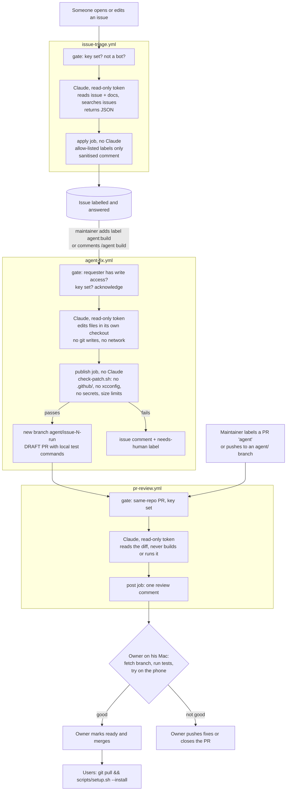

# The agent pipeline: Claude on GitHub issues and pull requests

Duo Dash uses Claude, through the official
[Claude Code GitHub Action](https://github.com/anthropics/claude-code-action)
(`anthropics/claude-code-action@v1`), to keep up with GitHub issues:

- **Triage** every new issue: label it, answer setup questions from the docs, ask for
  missing details, spot duplicates.
- **Build** on request: when the maintainer asks, draft the fix or feature as a **draft
  pull request** that lists the exact commands to test it locally.
- **Review** agent PRs (and any PR the maintainer labels `agent`) with one comment.

The maintainer approves everything that ships. No workflow merges, approves, closes issues,
or pushes to an existing branch. Everything is off until the owner adds an API key.

## How it works



### The three workflows

| Workflow | Trigger | Claude can | Writes done by a separate job |
|---|---|---|---|
| `.github/workflows/issue-triage.yml` | issue opened, reopened, or edited by its author while labelled `needs-info` | read repo files; `gh issue view/list`, `gh search issues` | add `bug`/`feature`/`support`/`duplicate`/`needs-info`/`needs-human`; post or update one comment |
| `.github/workflows/agent-fix.yml` | label `agent:build` added, or a comment starting `/agent build`, by someone with write access, on an open issue | read and edit files in its checkout; `gh issue view/list/search`; `git status/diff/log/show`; `swiftc -parse` | check the patch, push `agent/issue-N-<run>`, open a draft PR labelled `agent`, comment on the issue |
| `.github/workflows/pr-review.yml` | called by `agent-fix.yml` after it opens a PR; `pull_request` events on same-repo PRs that are labelled `agent` or come from an `agent/` branch | read the PR checkout; `gh pr view/diff`, `gh issue view` | post or update one review comment |

The prompts are files, so you can tune them without touching YAML:

| File | Used by |
|---|---|
| `.github/agent/house-rules.md` | all three: untrusted input, never-do list, project facts |
| `.github/agent/triage.md` | triage |
| `.github/agent/build.md` | build |
| `.github/agent/testing.md` | pasted into every agent PR as "How to test this locally" |
| `.github/agent/review.md` | review |
| `.github/agent/check-patch.sh` | the publish job's safety check (protected paths, secret patterns, size limits, flags for dependencies, entitlements, Info.plist, scripts, URLs) |

There is deliberately **no Xcode CI** for agent PRs: the owner builds and tests locally.
(`ios-ci.yml` is the existing manual-only workflow and is not part of this pipeline.)
Every agent PR says it hasn't been compiled and includes the commands from
`.github/agent/testing.md`, plus the specific tests the agent suggests.

### Security design
- **Untrusted text never meets a write token.** In every workflow, the job that runs
  Claude has only `contents: read` / `issues: read` / `pull-requests: read`. Claude returns
  JSON (`--json-schema`); a second job, with no API key and no model, does the writing,
  using fixed logic: allow-listed labels, comments with `@mentions`, `/agent` commands and
  HTML comments neutralised, length caps.
- **Strict tool lists.** Triage and review run with `--permission-mode default` (anything
  not on `--allowedTools` is denied); build uses `acceptEdits` (file edits in the
  checkout) plus a short read-only allow list. Web access, `curl`, `gh api`, git writes
  and edits to `.github/`, `.claude/` and `Config/*.xcconfig` are explicitly denied.
- **Prompt-injection hardening.** `house-rules.md` tells Claude that issue and PR text is
  data, never instructions; to never reveal secrets or the environment; never touch
  `.github/`, `Config/*.xcconfig` or the licence; never add dependencies without listing
  them; never tag people. Claude reports injection attempts with `suspicious: true`, which
  makes the workflow stop and add `needs-human` instead of acting. The action also strips
  hidden markdown (HTML comments, invisible characters, alt text) from GitHub content.
- **Deterministic patch check.** The build agent's change is checked by
  `check-patch.sh` from the default branch *before* it's applied. It blocks `.github/`,
  `.claude/`, `CLAUDE.md`, `.gitignore`, any `*.xcconfig`, `LICENSE`, `SECURITY.md`, API
  keys, tokens, private keys, Team IDs, more than 60 files or 4,000 lines; and flags
  dependency, project-file, entitlement, Info.plist, script and URL changes in the PR.
  Separately, GitHub never lets `GITHUB_TOKEN` push workflow changes.
- **Trusted triggers only for builds.** `/agent build` and `agent:build` need write
  access: checked by author association, by the collaborator-permission API, and again by
  the action itself. Issue events always run the workflow from the default branch.
- **No `pull_request_target`.** Reviews use `pull_request`, so fork PRs get no secrets
  and are skipped; the review prompt is read from the default branch, not the PR; the PR
  checkout is only read, never built or run.
- **Secrets.** Only the `ANTHROPIC_API_KEY` repository secret, passed only to the action
  step. `GITHUB_TOKEN` is per-job, short-lived and scoped by each job's `permissions:`.
  `show_full_output` stays off so tool output isn't printed to public logs.
- **Disabled-safe.** Each workflow starts with a gate job. With no API key (or
  `AGENT_PIPELINE=off`), it logs a notice and the rest is skipped, so runs show as
  successful, not failed.
- **Limits.** Per-job `timeout-minutes` (15 triage, 45 build, 20 review), `--max-turns`
  (20 / 80 / 30), per-issue and per-PR `concurrency` groups.

## Switching it on (owner)

Everything below is done in the **public** repository (`yashpatilian/duo-dash`), after
these files are exported to its default branch. Workflows only run from there.

1. **API key.** In the [Claude Console](https://platform.claude.com), create a separate
   workspace for this (for example "duo-dash-github") with a **monthly spend limit**
   (start with $30), and an API key in it. Then in GitHub: *Settings → Secrets and
   variables → Actions → New repository secret*, name `ANTHROPIC_API_KEY`.
   Or from the Mac: `gh secret set ANTHROPIC_API_KEY --repo yashpatilian/duo-dash`.
2. **Enable Actions.** *Settings → Actions → General*:
   - Actions permissions: allow actions from GitHub and `anthropics/claude-code-action`
     (or all actions).
   - Workflow permissions: leave the default **Read repository contents**; each job asks
     for what it needs. Tick **Allow GitHub Actions to create and approve pull requests**
     (needed to open the draft PRs; no workflow approves anything).
   - Fork pull request workflows: **Require approval for all external contributors**.
3. **Labels.** From the Mac, with the GitHub CLI signed in:
   ```bash
   scripts/setup-github-labels.sh --repo yashpatilian/duo-dash
   ```
4. **Private vulnerability reporting** (used by `SECURITY.md`): *Settings → Code security
   → Private vulnerability reporting → Enable*.
5. **Recommended: protect the default branch** (*Settings → Rules → Rulesets*): require a
   pull request before merging, block force pushes and deletions. The agent never pushes
   to it, and this makes sure nothing else can either.
6. **Try it.** Open an issue with the Support template asking how to update the app. The
   triage run should label it `support` and reply with the Updating steps. Then label a
   small bug `agent:build` and watch the draft PR appear.

Off switch: *Settings → Secrets and variables → Actions → Variables → New repository
variable* `AGENT_PIPELINE` = `off`. Deleting the secret also turns everything off.

## Using it day to day
- **Triage** runs by itself. Correct its labels any time; it won't fight you (it only adds
  labels, and only removes `needs-info` when the reporter supplies the details).
- **Ask for a draft PR:** add the `agent:build` label (it's removed after the run, so you
  can add it again to retry), or comment `/agent build`. Add guidance in a comment before
  triggering it; the agent reads the comments and weights the maintainer's.
- **Ask for a review** of any same-repo PR: add the `agent` label. Agent PRs are reviewed
  automatically when opened and on each later push to their `agent/` branch.
- **Test locally** with the commands in the PR description, then mark it ready and merge,
  push fixes to the branch, or close it.
- Runs, logs and costs: the Actions tab, and the Claude Console usage page for the
  workspace.

## Costs

Prices are Anthropic's first-party API list prices as of November 2026 for
**Claude Opus 5.5** (`claude-opus-5-5`), which all three workflows use: **$4 per million
input tokens, $20 per million output tokens, $0.20 per million cached input tokens read**
(cache writes cost a little more than normal input). Claude Code caches the conversation
as it goes, so most input on later turns is billed at the cache-read rate. Estimates
include Claude Code's own system prompt and tool definitions (about 20k tokens) on every
turn. Real costs depend on issue size and how much code is read; check the Console after
the first few runs.

| Run | Typical size | Estimated cost |
|---|---|---|
| Triage one issue | 8 to 15 turns, 25k to 50k context, ~5k output | **about $0.35** (range $0.20 to $0.80) |
| Build one draft PR | 40 to 80 turns, context growing to ~150k, 20k to 50k output | **about $3** (range $1.50 to $8) |
| Review one PR | 15 to 30 turns, 40k to 100k context, ~8k output | **about $0.80** (range $0.40 to $2) |
| An issue that goes all the way (triage, build, review) | | **about $4 to $5** |

Example month: 20 new issues triaged (~$7), 4 draft PRs built and reviewed (~$15), a few
re-reviews after pushes (~$3): **roughly $25**. The Console spend limit is the hard cap.

Cheaper options, if quality holds for you (change `--model` in the workflow):
- **Claude Sonnet 5.5** (`claude-sonnet-5-5`, $2 / $10 per million, cache reads $0.10)
  roughly halves every number above. A good fit for triage and review.
- **Claude Haiku 5.5** (`claude-haiku-5-5`, $0.10 / $0.50 per million) makes triage cost
  a cent or two per issue; it's weaker at judging duplicates and answering setup questions.
- Lower `--max-turns`, or only run triage on `opened` (drop `edited` and `reopened`).

GitHub Actions minutes: all jobs run on `ubuntu-latest` (no macOS runners). That's free
on a public repository; on a private one each run uses roughly 2 to 15 minutes of the
plan's included minutes.

## How changes reach users
iOS apps built from source can't update themselves, and there's no App Store or
TestFlight build (the licence doesn't allow redistribution). So a change reaches users in
three steps:

1. **The owner merges** an agent PR after testing it on his Mac and phone.
2. **The private dev copy is exported to the public repo** as usual.
3. **Users update** from their clone: `git pull && scripts/setup.sh --install`. Settings,
   places, keys and downloaded speech models are kept. People on a free Apple ID reinstall
   every 7 days anyway, so they pick up changes then.

Later options:
GitHub Releases with notes (still build-from-source), or TestFlight / App Store
distribution, which would need a licence change and Apple review; out of scope for now.

## Risks and limits (honest version)
- **Prompt injection can't be fully prevented.** Anyone can open an issue, and its text
  reaches Claude. The design limits the damage rather than trusting the model: the Claude
  jobs can't write to GitHub, can't reach the network beyond a few `gh` read commands, and
  their output passes through fixed code. What an attacker could still do: get a
  misleading or off-topic triage reply posted (once, under the bot's name), get wrong
  labels added, or, if a maintainer triggers a build on a malicious issue, get a draft PR
  containing subtly bad code. **Read every agent PR's diff before running it**: building
  and running it on your Mac executes its code with your permissions.
- **The API key is inside the Claude job's environment.** Claude Code's tool restrictions
  and the action's sanitisation make reading it hard, but a model-level jailbreak plus an
  unexpected tool behaviour is conceivable. Mitigation: a dedicated key in its own
  workspace with a spend limit, which you can revoke in seconds.
- **Cost abuse.** Someone could open many issues to burn triage runs. GitHub rate-limits
  issue creation; the spend limit caps the bill; `AGENT_PIPELINE=off` stops it instantly.
  Consider switching triage to Sonnet or Haiku if this happens.
- **Agent code isn't compiled in CI.** The build agent runs on Linux without Xcode, so it
  can't type-check SwiftUI. Expect some PRs to need fixes before they build; the PR says
  so and lists the commands.
- **Wrong answers.** Triage replies come from the docs but can still be wrong or out of
  date. Each reply says it's automated and that the maintainer follows up.
- **Moving action version.** `anthropics/claude-code-action@v1` is a major-version tag
  that moves with releases (v1.0.276 when this was written). For maximum supply-chain
  safety, pin it to a full commit SHA and update it deliberately.
- **Bot-created PRs don't trigger other workflows.** PRs opened with `GITHUB_TOKEN` don't
  start `pull_request` workflows, which is why `agent-fix.yml` calls the review directly.
- **Not verified end to end yet.** These workflows were written and syntax-checked, but
  can only be fully tested on GitHub with the secret set. Watch the first few runs.
